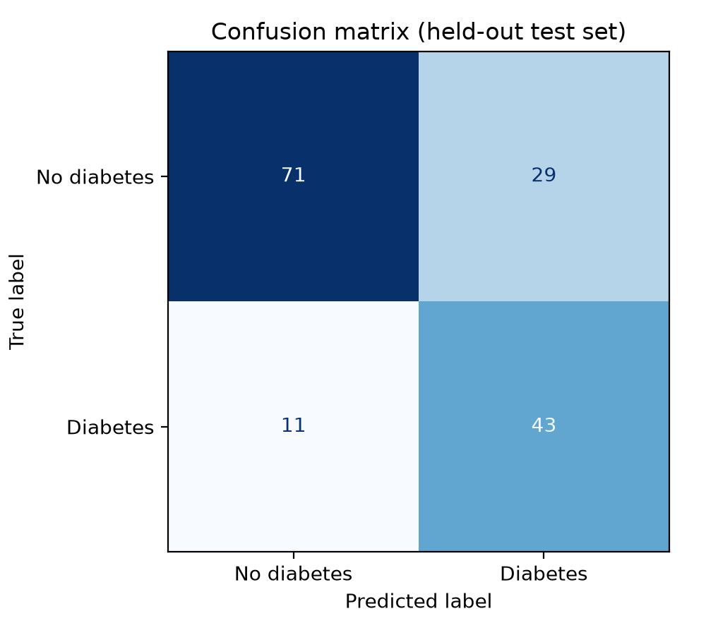
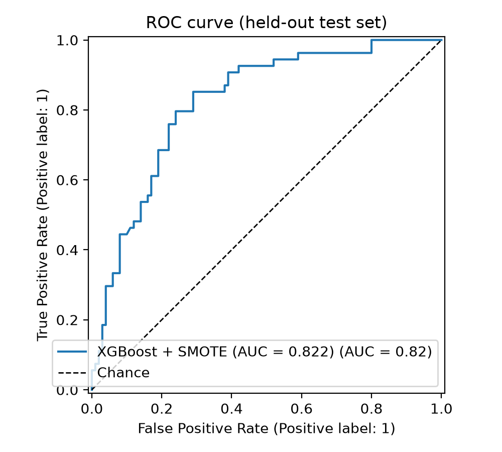
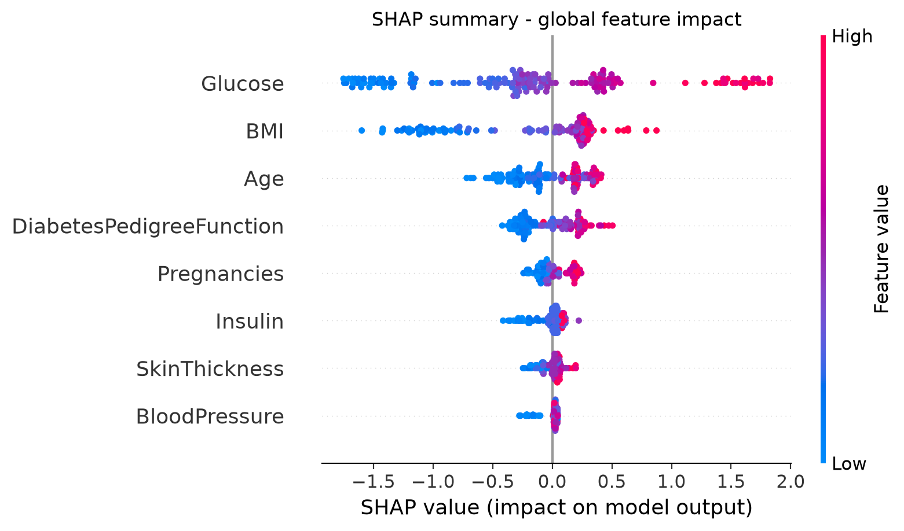
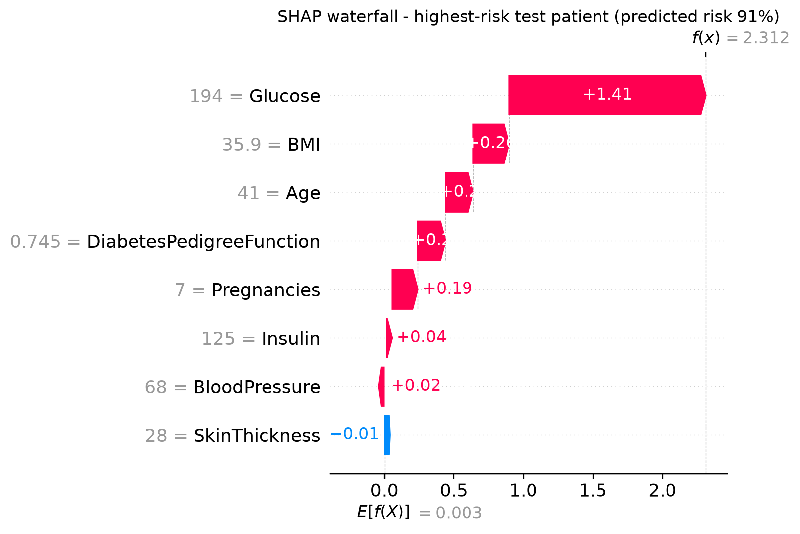

# 🩺 Explainable Diabetes Risk Prediction

**XGBoost · SMOTE · SHAP · Streamlit**

An interpretable, leakage-safe machine-learning pipeline that predicts diabetes risk from eight clinical measurements and **explains every individual prediction** with SHAP. Built on the PIMA Indians Diabetes dataset and delivered as an interactive Streamlit app.

**Author:** Hafsa Abbasi

---

## Table of contents

1. [Motivation](#motivation)
2. [Highlights](#highlights)
3. [Dataset](#dataset)
4. [Methodology](#methodology)
5. [Results and figures](#results-and-figures)
6. [Explainability with SHAP](#explainability-with-shap)
7. [The Streamlit app](#the-streamlit-app)
8. [Project structure](#project-structure)
9. [Installation and usage](#installation-and-usage)
10. [Deploying on Streamlit Community Cloud](#deploying-on-streamlit-community-cloud)
11. [Limitations and ethics](#limitations-and-ethics)
12. [Future work](#future-work)
13. [References](#references)

---

## Motivation

In clinical machine learning, accuracy alone is not enough: a clinician needs to know **why** a patient is flagged as high risk before trusting a prediction. This project pairs a tuned gradient-boosted model with **SHAP (SHapley Additive exPlanations)**, so each prediction comes with a feature-level, clinically readable justification instead of an unexplained score.

## Highlights

- **Model:** `XGBClassifier` (XGBoost), tuned with `GridSearchCV` using ROC-AUC.
- **Class imbalance:** handled with **SMOTE** (`imbalanced-learn`).
- **No data leakage:** the stratified 80/20 split happens first; imputation and SMOTE are fitted on training data only.
- **All 8 clinical features** of the PIMA dataset are used.
- **Explainable AI:** a global SHAP summary plot, plus a SHAP waterfall that explains the highest-risk test patient. The app produces a live waterfall for any patient you enter.
- **Evaluation beyond accuracy:** ROC-AUC, PR-AUC, precision, recall, F1, confusion matrix and ROC curve.
- **Portable model:** the best model is saved both as `model.pkl` and as XGBoost's version-independent `model.json`.
- **LLM-ready:** a "Chat with your report" section prepares a grounded, structured report that a language model can answer questions from.

## Dataset

| Property | Value |
|---|---|
| Source | [PIMA Indians Diabetes dataset](https://raw.githubusercontent.com/jbrownlee/Datasets/master/pima-indians-diabetes.data.csv) (originally from the National Institute of Diabetes and Digestive and Kidney Diseases) |
| Patients | 768 women of Pima Indian heritage, aged 21 and over |
| Target | `Outcome` (1 = diabetes, 0 = no diabetes), about 35% positive |
| Features (8) | Pregnancies, Glucose, BloodPressure, SkinThickness, Insulin, BMI, DiabetesPedigreeFunction, Age |

**Missing values.** In this dataset, a value of `0` in Glucose, BloodPressure, SkinThickness, Insulin or BMI is physiologically impossible and really means "not measured" (for example, 374 patients have no insulin measurement and 227 have no skin-thickness measurement). These zeros are converted to `NaN` and replaced with the **median** of the training set. Zeros in Pregnancies and Age are valid values and are left unchanged.

## Methodology

The order of operations is chosen to prevent data leakage:

```
Raw data
   │
   ├─ 1. Replace impossible zeros with NaN
   │
   ├─ 2. train_test_split  (80 / 20, stratified, random_state = 42)
   │         ├── X_train, y_train ──────────────┐
   │         └── X_test,  y_test  (kept untouched until final evaluation)
   │                                            ▼
   │                         3. Median imputation  (medians from X_train only)
   │                         4. SMOTE              (applied to X_train only)
   │                         5. XGBClassifier      (GridSearchCV, 5-fold, ROC-AUC)
   │
   └─ 6. Evaluate once on the untouched test set → metrics, plots, SHAP
```

Key design decisions:

- **Imputation and SMOTE live inside an `imblearn` pipeline.** During cross-validation they are fitted on the training part of each fold only, so validation folds consist of real, unsynthesised patients. SMOTE is automatically skipped when the model predicts on new data.
- **Hyper-parameter search:** `GridSearchCV` over `n_estimators` ∈ {100, 200, 300}, `max_depth` ∈ {3, 4, 5} and `learning_rate` ∈ {0.01, 0.05, 0.1} (27 combinations), with stratified 5-fold cross-validation and `scoring="roc_auc"`.
- **Decision threshold:** 0.5 for the High/Low label and the confusion matrix.
- **Reproducibility:** `random_state = 42` everywhere.

## Results and figures

Running `train.py` writes all metrics to `assets/metrics.json` and `assets/results_table.csv`. The file contains:

- cross-validated ROC-AUC (on the training set),
- test ROC-AUC and PR-AUC,
- accuracy, precision, recall and F1,
- the best hyper-parameters and the confusion matrix.

The test set is used exactly once, for the final evaluation.

### Confusion matrix (held-out test set)



### ROC curve (held-out test set)



## Explainability with SHAP

SHAP assigns every feature a contribution to each individual prediction. Contributions are computed with `shap.TreeExplainer`, which is exact and fast for tree models, and are expressed in log-odds.

### Global view: which features drive risk?



Each dot is one test patient. Position on the horizontal axis shows whether the feature pushes the prediction towards higher risk (right) or lower risk (left); colour shows the feature value (red = high, blue = low).

### Local view: why is this patient high risk?



The waterfall explains the highest-risk patient in the test set. It starts from the model's average output, E[f(x)], and each bar shows how one feature moves the prediction up (red) or down (blue). The bars add up exactly to the patient's final score, f(x).

## The Streamlit app

`app.py` provides an interactive interface:

- **8 input sliders:** Pregnancies, Glucose, BloodPressure, SkinThickness, Insulin, BMI, DiabetesPedigreeFunction and Age. Default values are the training-set medians.
- **Risk output:** a risk percentage and a High / Low risk label.
- **Live SHAP waterfall** for the entered patient, displayed at full width.
- **Clinical reasoning:** the three strongest SHAP drivers translated into plain language with a short clinical reference.
- **Chat with your report (LLM-ready):** the app builds a structured JSON report (inputs, risk, SHAP contributions) and a grounded prompt template. `answer_question()` currently returns a deterministic demo answer; connecting any language-model API there enables report-grounded question answering.

The app loads `assets/model.json` first and falls back to `assets/model.pkl`.

## Project structure

```
.
├── train.py            # data → split → impute → SMOTE → XGBoost (GridSearchCV) → metrics → SHAP
├── app.py              # Streamlit application
├── requirements.txt    # Python dependencies
├── README.md
└── assets/             # created by train.py
    ├── model.json              # best XGBoost model (native format, version-portable)
    ├── model.pkl               # best XGBoost model (pickle)
    ├── imputer_medians.json    # training-set medians (default slider values)
    ├── metrics.json            # CV ROC-AUC, test ROC-AUC, precision, recall, F1, ...
    ├── results_table.csv       # metrics as a table
    ├── confusion_matrix.png
    ├── roc_curve.png
    ├── shap_summary.png
    └── shap_waterfall.png
```

## Installation and usage

**Requirements:** Python 3.10 or newer.

### 1. Create an environment and install dependencies

macOS / Linux:

```bash
python -m venv .venv
source .venv/bin/activate
pip install -r requirements.txt
```

Windows (PowerShell or Command Prompt):

```bat
python -m venv .venv
.venv\Scripts\activate
pip install -r requirements.txt
```

### 2. Train the model

```bash
python train.py
```

This downloads the dataset, trains and tunes the model, evaluates it on the held-out test set, generates every plot, and writes all files into `assets/`.

### 3. Launch the app

```bash
streamlit run app.py
```

The app opens at `http://localhost:8501`.

### Google Colab (training only)

```python
!pip install -q -r requirements.txt
!python train.py
```

Then download the generated `assets/` folder.

## Deploying on Streamlit Community Cloud

1. Run `python train.py` and make sure the `assets/` folder is present.
2. Push the repository to GitHub, including `app.py`, `requirements.txt` and the whole `assets/` folder.
3. Go to [share.streamlit.io](https://share.streamlit.io), click **New app**, choose the repository and set the main file path to `app.py`.
4. Click **Deploy**. Streamlit installs the packages from `requirements.txt` and serves the app at a public URL.

**Troubleshooting: `XGBoostError: input stream corrupted`.** This error occurs when a pickled XGBoost model is loaded with a different XGBoost version than the one that saved it (for example, trained in Colab, loaded locally). The app avoids this by loading `assets/model.json` first, which is XGBoost's version-independent format. If it still occurs, re-run `python train.py` in the same environment that runs the app, and commit the regenerated `assets/` folder.

## Limitations and ethics

- **Single, small population.** The data covers 768 Pima Indian women aged 21 and over. Results may not generalise to men, other ethnic groups or other age ranges. The app states this on every page.
- **SMOTE and calibration.** SMOTE creates synthetic minority-class samples, which can shift predicted probabilities. Read the percentage as a **risk score**, not as the literal real-world probability of having diabetes.
- **Imputed values.** A large share of Insulin and SkinThickness values were missing in the original data and replaced by medians, which limits how much these two features can be trusted.
- **Explanations describe the model, not biology.** SHAP shows which inputs drive the model's output; it does not establish medical causation.
- **Not a medical device.** This is an educational and research prototype. It must not be used for diagnosis or treatment decisions. Always consult a qualified clinician.

## Future work

- Probability calibration (isotonic regression or Platt scaling) and decision-curve analysis.
- External validation on additional cohorts and subgroup fairness analysis.
- Comparison with other imbalance strategies (class weights, ADASYN, threshold tuning).
- A real language-model integration for the "Chat with your report" module, with safety guardrails.

## References

1. Smith, J. W., Everhart, J. E., Dickson, W. C., Knowler, W. C., & Johannes, R. S. (1988). Using the ADAP learning algorithm to forecast the onset of diabetes mellitus. *Proceedings of the Annual Symposium on Computer Application in Medical Care*, 261–265.
2. Chen, T., & Guestrin, C. (2016). XGBoost: A scalable tree boosting system. *Proceedings of the 22nd ACM SIGKDD International Conference on Knowledge Discovery and Data Mining*, 785–794.
3. Chawla, N. V., Bowyer, K. W., Hall, L. O., & Kegelmeyer, W. P. (2002). SMOTE: Synthetic minority over-sampling technique. *Journal of Artificial Intelligence Research*, 16, 321–357.
4. Lundberg, S. M., & Lee, S.-I. (2017). A unified approach to interpreting model predictions. *Advances in Neural Information Processing Systems*, 30.
5. Lundberg, S. M., et al. (2020). From local explanations to global understanding with explainable AI for trees. *Nature Machine Intelligence*, 2, 56–67.
